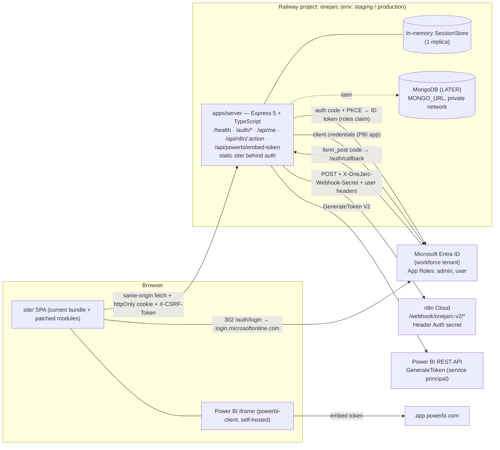

# OneJarc: GitHub Pages → GitHub + Railway, with Microsoft Entra ID sign-in

Status: **PLAN ONLY — nothing implemented.** Written 2026-11-24. Awaiting approval.
Scope: hosting + authentication migration of the **current** build (`site/`). Not the modular rebuild in `PLAN.md`; this plan is designed to fit underneath it.

Conventions: `B:<n>` = line in `site/assets/index-D3Sf9OYN.js` (the live, hand-patched bundle). Other paths are relative to the repo root. Line numbers were read from the working tree at `5f0dd20`. Items marked **[unverified]** could not be confirmed from official docs and must be tested.

> **Public repo rule.** This file describes weaknesses only at the level of "what class of problem, which file". Reproduction steps, live webhook behaviour and anything an attacker could use go only in `SECURITY-NOTES.md`, which is git-ignored (created during implementation, never committed). The same applies to `PLAN.md`, which is currently untracked: review it before committing it (decision D15).

---

## 0. TL;DR

- **Recommendation: do the migration now, on the current bundle, with ~70 small, logged edits** (`PATCHES.md`), rather than waiting for the source recovery in `PLAN.md` Phase 0. The bundle already has the right seams: one auth service object (`createPrototypeAuthService`, `B:9972-10007`) switches the whole app, and all 14 n8n actions go through 7 `fetch` call sites.
- **New:** a small TypeScript **Express 5** server in `apps/server/` that:
  - signs users in with **MSAL Node** (confidential client, auth code + PKCE, `form_post`);
  - keeps an **httpOnly session** (in-memory store behind a `SessionStore` interface, swappable for MongoDB);
  - reads roles **only** from the Entra `roles` claim (App Roles `admin` and `user`);
  - serves `site/` **behind auth**;
  - proxies n8n through an allow-list of actions (`/api/n8n/:action`) with role checks and a webhook secret;
  - generates **Power BI embed tokens server-side** (service principal, app-owns-data).
- **The browser no longer talks to n8n or holds any webhook URL.** CSP `connect-src` becomes `'self'`.
- **Railway:** Railpack build (no Dockerfile), `.railway/railway.ts` Infrastructure as Code (not `railway.json`, deprecated with a 2026-12-01 hard cutoff), 1 replica, `/health` check, `staging` environment on branch `railway-entra`, `production` on `main` only after cutover.
- **Cutover without breaking the live site:** new n8n webhook paths (`/webhook/onejarc-v2/...`) with Header Auth are used by Railway, while the old open webhooks keep serving GitHub Pages until the switch day. Then the old webhooks and the Pages site are turned off. Rollback = re-activate the old webhooks and Pages.

---

## 0.1 Approved scope for round 1 (2026-11-24) — supersedes the sections below where they differ

Round 1 is **functionality only**: the current build running on Railway with Entra sign-in. Everything removed from this round is listed in **§11 Later** so nothing is lost.

| Topic | Round 1 decision |
|---|---|
| D1 | Edit the current bundle now; every edit logged in `PATCHES.md` (file, location, before/after, reason) |
| D2 | Express 5 + TypeScript in `apps/server/` |
| D5 | Power BI: `PBI_EMBED_MODE=n8n` (default, as today: n8n get-tool-creds issues the embed token, now called only by the server) or `server` (service principal + GenerateToken). Both are built; the switch is an env var. |
| D8 | `form_post`. The short-lived auth-flow cookie (state/nonce/PKCE) is `SameSite=None; Secure; HttpOnly`; the session cookie is `SameSite=Lax; HttpOnly` |
| D16 | `site/assets/login.js` deleted |
| Sessions | `express-session` + in-memory store behind a `SessionStore` interface (MongoDB later). One instance; re-login after a redeploy is accepted |
| Entra | **One** app registration (test/staging) with a client secret. Production registration later |
| Admins (replaces App Roles / D18) | Env var `ADMIN_OBJECT_IDS` (comma-separated Entra object IDs, `oid` claim). In the list → admin; everyone else → normal user. `/api/me` returns `{ name, email, oid, isAdmin }`; the bundle maps `isAdmin` to its existing `role: "admin" | "user"` |
| Domain | Railway-generated `*.up.railway.app`; no custom domain yet |
| Serving | SPA at `/` with SPA fallback (server injects `<base href="/">`) and `no-cache` + ETag on every file plus a build-id check, so users never run mixed old/new files |
| Out of this round | CSP/helmet, CSRF tokens, rate limiting, n8n webhook secrets/HMAC, certificates, SECURITY-NOTES.md, rollback plan, Pages redirect, App Roles, CI workflow → §11 |

Deliverables: `apps/server/`, patched `site/`, `PATCHES.md`, `.railway/railway.ts`, `.env.example`, `SETUP-CHECKLIST.md`.

---

## 1. Findings (Phase 1 analysis)

### 1.1 Auth today

| What | Where | Note |
|---|---|---|
| Session key + lifetime | `B:9945-9946` (`DEMO_SESSION_KEY = "onejarc-demo-session-v1"`, 8 h) | |
| Session store (`{version, userId, user, expiresAt}`) | `createSessionStore` `B:9949-9968`, wired with `window.sessionStorage` at `B:10373` | Identity **and role** are held in browser storage |
| **Auth service (the seam)** | `createPrototypeAuthService` `B:9970-10007`: `restore()` 9974-9980, `signIn()` 9982-10001 (dynamic `import("./login.js")` at 9985), `signOut()` 10003-10005 | Its own comment (`B:9970`) says it is meant to be swapped for `/session`, `/login`, `/logout` adapters |
| Login webhook client | `site/assets/login.js:52-103` (`signInWithWebhook`), normaliser 31-50 | Username/password sent to n8n; role comes back and is trusted by the browser |
| AuthProvider | `B:10340-10438` (`use-auth.tsx`). `restore` on mount, **every 60 s** (`B:10383`) and on focus (`B:10384`); `expireSession` `B:10360-10366` on any API 401 | The 60 s poll becomes our free session-expiry check |
| Dormant company-auth hook | `getCompanyAuthService` `B:10288-10304`, `companyMode` `B:10352-10353` | Unused: `workspaceConfig` is forced local at `B:10034` |
| Login screen | `LoginScreen` `B:18375-18610`; password form 18382-18404 / 18526-18592; company-sign-in button branch already exists at `B:18502-18524` | Disclaimer copy `B:18597` |
| Gate | `AuthenticatedHub` `B:37038-37046` (LoginScreen when no user; providers keyed by `user.id + ":" + user.role`, 37045) | |
| Roles | `ONEJARC_ROLES = ['user','admin']` `site/assets/tool-categories.js:56-57`; `grants` `B:12038-12041`; `can()` `B:12043-12045`; `requirePermission` `B:12047-12049` | `can()` reads a single `user.role` string |
| Permission checks | ~40 call sites (catalog 12067-12117, API catalog 12355-12415, access requests 12600/12614, admin UI 31788-32639, hub 35700-36340) | **All client-side only.** No server enforces anything today |
| Other role uses | profile label `B:35661`; dormant `getMe` validator `B:12656-12665`; role table `B:32679-32689`; Power BI `allowedRoles` in tool data (`B:11877`, `B:31905-31912`, `tool-categories.js:58-70`, `tool-variables.js:14,25,30`, `create-tool.js:16`, `get-tools.js:40`) | `allowedRoles` strings must equal the Entra App Role values (→ use `admin` / `user`) |
| Identity sent to n8n | `launch-tool.js:7-17` posts `{toolName, email, role}` built from the browser session (`B:35948-35952`) | n8n decides access on values the browser supplies |

**Class of problem (details → `SECURITY-NOTES.md`):** identity and role are asserted by the browser and never verified by a server; every webhook, including admin-level ones, is callable without credentials.

**Roles to create as Entra App Roles:**

| App Role value | Today's permissions (`B:12020-12037`) |
|---|---|
| `user` | canViewTools, canFavoriteTools, canUseSearch, canOpenTools, canRequestAccess |
| `admin` | everything in `user` + canManageToolCatalog, canCreateTool, canEditTool, canDuplicateTool, canArchiveTool, canDeleteTool, canPublishTool, canEnableTool, canManageCategories |

### 1.2 Outbound calls

7 `fetch` call sites cover 14 n8n actions. All n8n traffic goes to `jarc-juno.app.n8n.cloud`.

| # | Action | URL source | Call site | Method / body | Response used | Who may call | Today's frontend exposure |
|---|---|---|---|---|---|---|---|
| 1 | Runtime config | `./onejarc-config.json` | `B:37158` (`credentials:"omit"` at 37160); re-fetched by `login.js:17-18` | GET | `parseRuntimeConfig` `B:37094-37126`, merged by `Object.assign` `B:37167` | anyone (pre-login) | all webhook URLs (`site/onejarc-config.json` lines 3, 4, 44-46) |
| 2 | Login | `loginWebhookUrl` | `login.js:68` | POST `{username,password}` | `{success,user:{id,username,displayName,role}}` | anonymous | URL; **retired by this migration** |
| 3 | Chat | `chatWebhookUrl` | `B:10223` via `createApiClient` (headers `B:10199-10209`, `credentials:"omit"` `B:10228`, `redirect:"error"` `B:10230`) | POST `{message}` ≤2000 chars | `reply\|output\|message` | user | URL (also printed in UI status text, `B:12792-12794`) |
| 4 | Get tools | `getToolsWebhookUrl` | `get-tools.js:85` (`credentials:'omit'` :88) | GET | array or `{tools}`; mapping `get-tools.js:15-76` | user | URL; full catalog incl. drafts and Power BI workspace ids goes to every user |
| 5 | Create tool | `createToolWebhookUrl` | `create-tool.js:23` (:26) | POST tool payload (3-18) | `{success}` | admin | URL |
| 6 | Delete tool | constant `PASTE_…` `delete-tool.js:3` | `delete-tool.js:10` (:13) | POST `{id}` | `{success}` | admin | placeholder (not connected) |
| 7 | edit, duplicate, publish, unpublish, enable, disable, archive, restore | `WEBHOOK_URL` constants (`edit-tool.js:5`, others line 4), all `PASTE_…` | **one helper:** `tool-webhook-client.js:7` (URL checks :3-5) | POST `{action,id,requestId,publish,entry}` | `{success}` | admin | placeholders (not connected) |
| 8 | Get tool creds / launch | **hardcoded** `launch-tool.js:9` (config key `getToolCredsWebhookUrl` is validated, `B:37115`, but unused) | `launch-tool.js:9`, from `openToolWorkspace` `B:35940-35952` | POST `{toolName,email,role}` | `{authorized, category, reportId, embedUrl\|targetUrl, accessToken}` | user (+ tool's `allowedRoles`) | URL; **Power BI embed token** returned to the browser (unavoidable for embedding, but today it is issued on browser-asserted identity) |
| 9 | Power BI SDK | `index.html:12` jsDelivr `powerbi-client@2.23.1` | | script, no SRI | `window.powerbi` | | third-party script |
| 10 | Power BI embed | `embedUrl` from #8 | `launch-tool.js:136-151` | iframe via SDK | | user | **no token refresh**: report stops working when the token expires (~1 h) |
| 11 | Generic tool iframe | `targetUrl` from #8 | `launch-tool.js:154-170` | iframe, no `sandbox` | | user | any https host |
| — | Dead fallback | `https://jarctech-ai-n8n-rnd.onrender.com/webhook` `B:10020`, required by `validateBackendConfig` `B:10053` | never called | | | | host string only; leave, CSP blocks it |

**Blockers for "just change the URLs in the config":**
- `validateChatWebhookUrl` (`B:10073-10082`) requires an **absolute `https:`** URL. A relative `/api/n8n/chat` fails page load (`B:37111-37115`, error at `B:37187`).
- `credentials:"omit"` at 5 call sites means the session cookie would not be sent even same-origin.
- `redirect:"error"` at 5 sites means `/api/*` must answer **401 JSON**, never a 302 to the login page.
- Launch (#8) and the 9 action URLs (#6, #7) are hardcoded in code, not read from config.

### 1.3 Build and serve

- **Load graph:** `index.html` → (blocking) jsDelivr Power BI SDK, `./juno-logo.svg`, `./assets/index-FdIXYUh7.css`, `./assets/index-D3Sf9OYN.js`.
  - The bundle statically imports `tool-categories.js`, `tool-variables.js`, `tool-actions.js` (→ 8 adapters → `tool-webhook-client.js`), `create-tool.js`, `delete-tool.js`, `get-tools.js` and `launch-tool.js` (`B:1-2`, `B:22-26`).
  - It dynamically imports `login.js` (`B:9985`).
  - Before React mounts, it fetches `new URL("./onejarc-config.json", location.href)` (`B:37156-37179`).
- **No server logic needed today.** Routing is hash-only (`readAdminRoute` `B:12051-12055`, hashchange `B:35693-35696`). No `pushState` routing.
- **The `/OneJarc/` base path is not in the code.** Searches for `/OneJarc`, `BASE_URL`, `github.io` and `<base>` found nothing. Vite was built with `base:'./'` (`git show 10158f0:vite.config.mjs`). The path only exists because Pages serves the project site at `/<repo>/`.
  - **The real constraint:** every URL is document-relative, so the page must be served at a path ending in `/`. A deep path such as `/foo/bar` returning `index.html` would break the config fetch, the assets and the logo.
  - **Serving at the domain root `/` works unchanged.**
- **Caching is broken by design today.**
  - `index-D3Sf9OYN.js` has had **15 different contents under one name** (54 commits).
  - The 17 modules, the config and `index.html` have fixed names and no cache-busting.
  - There is no service worker.
  - Pages deploys are delete-and-re-upload through the web UI (32 "Add files via upload" + 29 "Delete site directory" commits).
- **Pages workflow** (`.github/workflows/pages.yml`) is `workflow_dispatch` only (lines 4-5). **Pushing any branch does not deploy Pages.**

### 1.4 State and storage (candidates for MongoDB later)

| Data | Key / place | Code | Scope today | Later home |
|---|---|---|---|---|
| Auth session | sessionStorage `onejarc-demo-session-v1` | `B:9945-9968`, `B:10373` | per tab | **removed** → server session (`sessions`) |
| Tool catalog cache | localStorage `onejarc-tool-catalog-github-empty-v1` | `B:12274-12347`, sync `B:18664-18669` | per device, shared by all users, up to several MB | `tools` + `catalog_meta` (the catalog already lives in a Mongo behind n8n, judging by the `_id` mapping in `get-tools.js:15-76`) |
| Favorites | `onejarc-user:<id>:northstar-favorites` | `hub-storage.ts` `B:12438-12523`, used from `HubContent` `B:35659`, `35729`, `35850`, `35916` | per user per device | `user_favorites` |
| Recents (cap 6) | `…:northstar-recent` | `B:35953` | per user per device | `user_recents` |
| Access requests (toolIds only; reason/urgency dropped) | `…:northstar-access-requests` (written twice: `B:12620` and the snapshot save at `B:35850`) | `B:12611-12625`, `B:36050` | per user per device | `access_requests` |
| Preferences (theme, reduceMotion, statusAlerts, maintenanceBanner, compactCards) | `northstar-preferences` (**not** user-scoped, `B:12441/12445`) | `B:12449-12457`, `B:36951` | per device | `user_preferences` (or keep appearance per device) |
| Read notifications | `…:northstar-read-notifications` | `B:36056`, `B:36759` | per user per device | `notification_reads` |
| Status subscription | `…:northstar-status-subscription` | `B:36292` | per user per device | `user_preferences.statusSubscribed` |
| Suggestions (cap 20) | `northstar-suggestions` (raw localStorage, not user-scoped) | `B:12525-12534`, `B:12633` | per device | `suggestions` |
| Sidebar | cookie `sidebar_state` (written `B:34662`, never read) | | per device | stays client-side |
| Chat | **in memory only**, no history (`useChatController` `B:12756-12806` deliberately avoids storing text) | | none | `chat_messages` only if a history feature is wanted (D13) |

- **Moving origin resets all of the above.** localStorage is per origin, so users start with empty favorites and recents on the Railway domain.
- The user id also changes from the n8n login id to the Entra `oid`, but that no longer matters once the origin has changed.
- Accept the reset, or let users export and import their data (D12).

### 1.5 Feasibility: edit the bundle now, or wait for source recovery?

**Recommendation: edit now, with a patch log.**

- **The edits are small and contained.** About 35 lines go into 4 bundle regions (`auth-service.ts`, `use-auth.tsx`, `login-screen.tsx`, `backend-config.ts`/`api-client.ts`), plus about 1-6 lines in each of 6 sibling modules and `index.html`. The auth service is already a swappable async interface, and the company-sign-in button branch already exists.
- **Nothing in Phase 0 makes these edits easier.** Phase 0 only adds tests around them. Its `region-diff.mjs` compares regions, so it will flag these edits for porting into TypeScript anyway; `PATCHES.md` makes that port mechanical.
- **Waiting means days** of source recovery before any security improvement. Meanwhile the current security problem stays live on the public site.
- **Conditions:**
  1. Tag the current `site/` as `pre-railway` before editing.
  2. Record every bundle edit in `PATCHES.md`: file:line, region, before/after, reason.
  3. Edit from the bottom of the file upward, so the earlier line numbers in this plan stay valid while you work.
  4. Update `PLAN.md` afterwards (D14):
     - Phase 0's "identical to `site/@5f0dd20`" target becomes the post-migration commit.
     - Phase 2 (n8n-issued token) is replaced by this server.
     - `packages/backend-n8n` becomes a client of `/api/n8n/*`.

---

## 2. Target architecture



**Trust boundary:** everything the browser sends is input. Identity and roles exist only in the server session, which is filled from the validated ID token. n8n trusts only requests that carry the webhook secret, and takes the user from headers that the server sets.

---

## 3. Server design (`apps/server`)

**Stack:**
- Node 22 LTS, Express 5.3, TypeScript 5.9, ESM.
- `@azure/msal-node` 7.x (Node ≥20), `express-session` 1.19, `helmet` 8.3, `express-rate-limit` 8.7, `pino` 10 + `pino-http` 11.
- `zod` for env and body validation.
- Tests use `vitest` + `supertest`.

### 3.1 Routes

| Route | Auth | Purpose and behaviour |
|---|---|---|
| `GET /health` | none, no rate limit | `200 {"ok":true,"version":RAILWAY_GIT_COMMIT_SHA}`. Checks no dependencies, so an n8n outage can't fail a deploy. Railway calls it from `healthcheck.railway.app`; don't filter by Host. |
| `GET /auth/login?returnTo=/#/admin` | none | Generates `state`, `nonce` and PKCE verifier/challenge (`CryptoProvider.generatePkceCodes`). Stores them, plus a **validated** `returnTo` (must be a same-origin path starting with `/`; anything else falls back to `/`), in a short-lived encrypted `__Host-onejarc.authtx` cookie (10 min, `SameSite=None; Secure; HttpOnly`). Then 302 to `getAuthCodeUrl({responseMode:'form_post', codeChallenge, codeChallengeMethod:'S256', state, nonce, scopes:['openid','profile','email']})`. |
| `POST /auth/callback` | the authtx cookie | Steps, in order: 1. decrypt authtx and compare `state` in constant time; 2. `acquireTokenByCode({code, codeVerifier, redirectUri, scopes})`; 3. check `idTokenClaims.nonce === tx.nonce`, `tid === ENTRA_TENANT_ID` and `aud === ENTRA_CLIENT_ID`; 4. map `roles` claim to app roles; **no recognised role → 403 page** (Assignment required should prevent this anyway); 5. `req.session.regenerate()` (prevents fixation); 6. set `session.user = {id: oid, name, email: email ?? preferred_username, roles, sid, tid}` and `session.csrfToken = randomBytes(32)`; 7. save, clear authtx, 302 to `returnTo`. **Tokens are not stored.** The MSAL account is removed from the client cache right after (`getTokenCache().removeAccount`) so memory doesn't grow. Audit `auth.login`. |
| `GET /auth/logout` | session (optional) | Destroys the session, clears the cookie, then 302 to `https://login.microsoftonline.com/{tenant}/oauth2/v2.0/logout?post_logout_redirect_uri=APP_BASE_URL/auth/signed-out`. Audit `auth.logout`. GET is acceptable because forced logout is harmless; it can become a POST once the bundle is rebuilt. |
| `GET /auth/signed-out` | none | Small static page with a "Sign in again" link. It's outside the auth gate so logout doesn't loop back into sign-in. |
| `GET /auth/frontchannel-logout` | none (Entra calls it in an iframe) | Looks up the session by `sid` query parameter (sid→session index in the store) and destroys it. Always returns 200. **[unverified exact params; optional, D9]** |
| `GET /api/me` | session | `{user:{id,name,email}, roles:["admin","user"], csrfToken, expiresAt}`. Returns **401 JSON** when not signed in, never a redirect. |
| `POST\|GET /api/n8n/:action` | session + role | Proxy, §3.2. |
| `POST /api/powerbi/embed-token` | session + role | §3.3. |
| `GET /*` static | session | `site/`, §3.4. No session for an HTML request → 302 `/auth/login?returnTo=<path>`. No session for anything else → 401. |

**Middleware order:**
1. `trust proxy`
2. `pino-http` with a request id taken from `X-Railway-Request-Id`
3. `helmet`
4. `/health`
5. rate limits
6. `express.json({limit:'1mb'})`, with an explicit 6 MB limit only on `create-tool` and `edit-tool` because of base64 icons
7. session
8. CSRF and origin check
9. `/auth`
10. `/api` (`requireAuth`)
11. static (`requireAuth`)
12. 404 / JSON error handler. In production it never leaks stack traces.

**Session settings:**
- Cookie name `__Host-onejarc.sid`: `HttpOnly`, `Secure`, `SameSite=Lax`, `Path=/`, no `Domain`.
- Absolute lifetime **8 h**, matching today's `DEMO_SESSION_DURATION`. Idle timeout 2 h via `rolling:true` with `maxAge` 2 h, plus an `absoluteExpiresAt` checked on each request.
- `resave:false`, `saveUninitialized:false`.
- `SESSION_SECRET` is an array, so it can be rotated.
- The store is `ExpressStoreAdapter(new MemorySessionStore())` (§8.1). **It requires exactly 1 replica**: Railway has no sticky sessions, and users must sign in again after each redeploy.

**Why `form_post` + a separate authtx cookie:**
- Microsoft recommends `form_post` for web apps, because the code never appears in URLs or logs.
- That callback is a cross-site POST, so a `SameSite=Lax` session cookie is **not** sent with it. The login transaction therefore lives in its own `SameSite=None` cookie that lasts 10 minutes, while the main session stays Lax.
- The alternative is `responseMode:'query'` with everything kept in the Lax session. It's simpler but the code appears in the URL. See D8.

### 3.2 n8n proxy: `/api/n8n/:action`

A fixed allow-list. Unknown action → 404. An action whose URL is unset → **501** `{"success":false,"error":"Not connected yet"}`, which keeps today's behaviour for the 9 `PASTE_` actions.

| action | Method in | Env var for upstream URL | Required role | Server-side extras |
|---|---|---|---|---|
| `chat` | POST | `N8N_URL_CHAT` | user | body `{message: string ≤2000}` validated |
| `get-tools` | GET | `N8N_URL_GET_TOOLS` | user | for non-admins, optionally strips drafts, archived and disabled entries (flag `CATALOG_FILTER_NON_ADMIN`, D11). Response cached 30 s for `/api/powerbi/embed-token` lookups |
| `create-tool` | POST | `N8N_URL_CREATE_TOOL` | admin | audit `tool.create` |
| `delete-tool` | POST | `N8N_URL_DELETE_TOOL` | admin | audit `tool.delete` |
| `edit-tool`, `duplicate-tool`, `publish-tool`, `unpublish-tool`, `enable-tool`, `disable-tool`, `archive-tool`, `restore-tool` | POST | `N8N_URL_EDIT_TOOL` … `N8N_URL_RESTORE_TOOL` | admin | audit `tool.<action>`; the body's `action` must match the path |
| `get-tool-creds` | POST | `N8N_URL_GET_TOOL_CREDS` | user | **overwrites** `body.email` and `body.role` with session values, so the existing n8n workflow keeps working unchanged |

**Every upstream request:**
- Is `POST`, or `GET` for get-tools, to the env URL, with `AbortSignal.timeout(N8N_TIMEOUT_MS)` (default 60 s).
- Carries these headers:
  - `X-OneJarc-Webhook-Secret: <N8N_WEBHOOK_SECRET>`
  - `X-OneJarc-User-Id: <oid>`
  - `X-OneJarc-User-Email`
  - `X-OneJarc-User-Roles: admin,user`
  - `X-OneJarc-Request-Id`
- Has the browser's own headers dropped.
- Has its response passed back with status and JSON body as-is, with a 2 MB size cap. A non-JSON upstream answer becomes `502 {"success":false,"error":"Upstream error"}`.
- Never forwards upstream redirects.

**Admin actions:**
- Get their own rate limit: 60 per hour per user.
- Are logged through `audit.info({audit:true, action, actor:{id,email}, roles, target:{toolId}, result:'ok'|'denied'|'error', requestId, ip})`.
- Denied attempts (403) are audited too.

### 3.3 Power BI: `/api/powerbi/embed-token`

**Model: app-owns-data with a service principal.**
- All users are in one workforce tenant, but access is decided by **OneJarc's own App Roles and the tool's `allowedRoles`**, not by Power BI workspace permissions.
- Users need no Power BI licence. Workspaces must be on a capacity (F/A/P SKU) for production; trial tokens are for development only and show a banner.
- **User-owns-data fits better only if** everyone already has Pro/PPU (or there's P/F64+) **and** you want Power BI permissions and RLS to be the source of truth. It would need delegated scopes and a per-user token cache, which means MongoDB. See D5.

**Request and response:**
- Request: `POST {toolId}`.
- Server steps:
  1. Load the tool from the cached catalog (`get-tools`).
  2. Require `published && enabled && !archived` and `category === "Power BI"`.
  3. Require that the intersection of `allowedRoles` and the session roles is not empty (admins always pass).
  4. Resolve `workspaceId` and `reportId` (open question Q3: where `reportId` lives today).
  5. Get an app-only token via a **singleton** `ConfidentialClientApplication(PBI_*)`, `acquireTokenByClientCredential({scopes:['https://analysis.windows.net/powerbi/api/.default']})`, served from MSAL's in-memory app cache.
  6. `GET /v1.0/myorg/groups/{ws}/reports/{id}` for `embedUrl` and `datasetId`.
  7. `POST https://api.powerbi.com/v1.0/myorg/GenerateToken` with `{reports:[{id,allowEdit:false}], datasets:[{id}], targetWorkspaces:[{id:ws}], identities: RLS ? [{username: user.email, roles:[…], datasets:[…]}] : undefined, lifetimeInMinutes: 60}`.
- Response: `{reportId, embedUrl, accessToken, expiration}`. Audit `powerbi.embed` (info level).

**Token lifetime:**
- Microsoft: *"the lifetime of the embed token is set to the remaining lifetime of the Microsoft Entra token used to call the GenerateToken API."*
- So if the cached app token has 8 minutes left, the embed token lasts 8 minutes. The server therefore forces a fresh app token when the cached one has under 20 minutes left (`forceRefresh:true`), and always returns `expiration`.
- **Client refresh (new code in `launch-tool.js`):**
  - Keep the `report` object from `powerbi.embed`.
  - Schedule a refetch 5 minutes before `expiration`, and also re-check on `visibilitychange`.
  - Then call `report.setAccessToken(token)`.

**Rollout in two stages:**
- **Stage A (cutover):** `launch-tool.js` calls `/api/n8n/get-tool-creds`. n8n still creates the embed token, but now behind the secret and with server-set identity.
- **Stage B:** `launch-tool.js` calls `/api/powerbi/embed-token` for Power BI tools, and the n8n workflow stops issuing tokens.

### 3.4 Serving the SPA

- `express.static(STATIC_DIR = "site")` with `index: "index.html"` and `redirect: true`. The redirect matters: `/` serves `index.html`, and a directory without its trailing slash gets one.
- **No SPA fallback.** Routing is hash-based, so the server only ever needs `/`. Unknown paths return 404, so a missing `.js` or `.json` can't come back as HTML and fail with a confusing MIME or JSON error.
- **Redirects:**
  - `GET /OneJarc` and `/OneJarc/*` → 301 to `/`, for anyone who has the old Pages path pasted.
  - `GET /index.html` → `/`.
- **Cache headers**, until the source rebuild makes hashes real:

| Files | `Cache-Control` | Why |
|---|---|---|
| `/`, `index.html`, `/auth/signed-out` | `no-cache` + ETag | always revalidate |
| `/onejarc-config.json` | `no-store` | runtime config |
| `/assets/*.js`, `/assets/*.css` | `no-cache` + strong ETag | the "hashed" names are **not** content-addressed today, so `immutable` would freeze stale code |
| `/vendor/powerbi-client-2.23.1.min.js`, `/juno-logo.svg` | `public, max-age=86400` | versioned by name |
| after `PLAN.md` Phase 0 (real Vite hashes) | `/assets/*-[hash].*` → `public, max-age=31536000, immutable` | |

- **Users never get a mix of old and new files:**
  1. Each Railway deploy is an immutable container image. A given instance always serves one consistent set of files.
  2. Every non-vendor file revalidates on each page load.
  3. The server adds `X-OneJarc-Build: <commit sha>` to every response and includes the build id in `/api/me`.
  4. During Railway's short deploy overlap, a page could load `index.html` from the old instance and modules from the new one. To catch this, `restore()` compares the build id in `/api/me` with the one in `<meta name="onejarc-build">`, which the server injects into `index.html` when serving it. A mismatch triggers one `location.reload()`, guarded by a sessionStorage flag so it can't loop.
  5. Set `RAILWAY_DEPLOYMENT_OVERLAP_SECONDS` low, e.g. 10.
- **`index.html` is served through a tiny template step** (read once at boot, cached) that injects that build `<meta>`. Nothing else in it changes at runtime.
- **The config file is behind auth** like everything else, and its fetch at `B:37160` changes to `credentials:"same-origin"`. After migration it contains only same-origin paths and no URLs worth hiding, but gating it keeps the rule simple: only `/health` and `/auth/*` are public.

### 3.5 Security

- **Helmet + CSP.** Every directive is set explicitly; staging runs **Report-Only** for a week first, D10.
  ```
  default-src 'self'; script-src 'self'; style-src 'self' 'unsafe-inline';
  img-src 'self' data:; font-src 'self'; connect-src 'self';
  frame-src https://app.powerbi.com <FRAME_SRC_EXTRA hosts of iframe tools>;
  frame-ancestors 'none'; form-action 'self' https://login.microsoftonline.com;
  base-uri 'self'; object-src 'none'; upgrade-insecure-requests
  ```
  - The Power BI SDK is **self-hosted**: `node_modules/powerbi-client/dist/powerbi.min.js` is copied to `site/vendor/` at build, and `index.html:12` changes. That removes jsDelivr from `script-src`.
  - The parent page talks to the report iframe through `postMessage`. The report's own traffic falls under Power BI's CSP, not ours.
  - `frame-src` must list every host that n8n returns as `targetUrl` for embedded tools (Q4). In Report-Only mode, violations show up in the console and logs without breaking anything.
  - `style-src 'unsafe-inline'` is kept for now because Base UI / Floating UI may inject styles. Tighten it after the rebuild.
  - Other headers: HSTS (1 year, includeSubDomains; preload later), `X-Frame-Options: DENY`, `Referrer-Policy: no-referrer` (also protects the auth code), COOP `same-origin`, CORP `same-origin`, `X-Content-Type-Options: nosniff`.
  - `Permissions-Policy`: deny camera, microphone and geolocation; allow `fullscreen` for self and Power BI.
- **CSRF.** Two layers on every unsafe method (`POST/PUT/PATCH/DELETE`) under `/api`:
  1. **Origin check:** if `Sec-Fetch-Site` is present it must be `same-origin`. Otherwise `Origin` must equal `APP_BASE_URL`; a missing or `null` Origin is rejected. `Content-Type` must be `application/json`.
  2. **Synchronizer token:** `X-CSRF-Token` must match `session.csrfToken` (`crypto.timingSafeEqual`). The token comes from `/api/me`.

  `/auth/callback` is exempt, because it's cross-site by design and protected by state, nonce and PKCE. `csurf` is not used (deprecated). There is no CORS middleware, so cross-origin requests have no way in.
- **Cookies:** as in §3.1. `app.set('trust proxy', 1)`:
  - Railway sets `X-Forwarded-Proto: https`, so `req.secure` works and secure cookies are issued.
  - For the client IP, use the documented `X-Real-IP` header. Read it via a custom `keyGenerator` wrapped in `ipKeyGenerator`, and trust it only when the request came through the edge (`X-Railway-Edge` present).
  - **Never** `trust proxy: true`.
  - **Verify on staging** by sending a spoofed `X-Forwarded-For` and checking the logged IP [unverified hop count].
- **Rate limits:**
  - `/auth/*`: 20 per 15 min per IP.
  - `/api/*`: 300 per 15 min per user (falls back to IP).
  - Admin n8n actions: 60 per hour per user.
  - `/api/powerbi/embed-token`: 60 per hour per user.
  - Use `standardHeaders:'draft-8'`. The memory store is fine with a single instance.
- **Audit log:** pino JSON on stdout with `formatters.level` mapping to a string label, so Railway recognises severities. An `audit` child logger records login, logout, denied access, every admin n8n action and embed-token issuance.
  - `redact` covers `req.headers.cookie`, `authorization`, `x-onejarc-webhook-secret`, `*.accessToken`, `*.password` and `*.token`.
  - Railway retention: Hobby 7 days, Pro 30 days. Not durable, so it becomes a Mongo `audit_log` collection later (§8).
- **Secrets:**
  - They come only from Railway variables, **sealed** where marked in §5.
  - Locally they come from `.env`, which is git-ignored.
  - `config.ts` fails fast on a missing variable. Values are never logged; boot logs only *which* variables are set.
- **Shutdown:** on SIGTERM, `server.close()`, then exit within 10 s. Railway's draining time is about 15 s.
- **Body limits and validation:** `zod` schemas for `chat`, `embed-token` and the action envelope. The create and edit tool payloads are passed through but must be JSON objects within the size limits.

---

## 4. Frontend changes (exact)

All of these are hand edits to built files. Each one gets a `PATCHES.md` entry. Apply bundle edits **from the bottom of the file upward** so the earlier line numbers stay valid. "Lines" below refer to `5f0dd20`.

### 4.1 Bundle `site/assets/index-D3Sf9OYN.js`

| # | Line(s) | Region | Change |
|---|---|---|---|
| F1 | `B:37160` | `runtime-config` | `credentials: "omit"` → `"same-origin"`. The config is now behind auth. |
| F2 | `B:18500`, `18502`, `18507`, `18513`, `18521-18524`, `18597` | `login-screen.tsx` | Always render the company sign-in branch (`auth.companyMode ?` → `true ?` at 18502). Drop `\|\| !auth.companyReady` at 18507. At 18513, `await auth.beginCompanySignIn()` → `window.location.assign("/auth/login?returnTo=" + encodeURIComponent(location.pathname + location.hash))`. Adjust the copy at 18500, 18521-18524 and 18597 ("Sign in with your company Microsoft account"). The password form (18526-18592) becomes unreachable and is left in place. |
| F3 | `B:12043-12045` | `permissions.ts` | **No change needed**, because F6 maps roles to one `role`. Changing `can()` to accept `roles[]` is left for the rebuild. |
| F4 | `B:10360-10366` | `use-auth.tsx` `expireSession` | Replace the `service.signOut()` call with `setUser(null)` plus the existing message. That shows the LoginScreen ("session expired, sign in again") **instead of** redirecting to the Entra logout. |
| F5 | `B:10228` and headers block `B:10199-10209` | `api-client.ts` | `credentials:"omit"` → `"same-origin"`. Add `"X-CSRF-Token": globalThis.__ONEJARC_CSRF__ ?? ""` to the request headers. Keep `mode:"cors"`, which is harmless same-origin. |
| F6 | `B:9974-10005` | `auth-service.ts` | Replace the three method bodies (see the code after this table). |
| F7 | `B:10073-10082` | `backend-config.ts` `validateChatWebhookUrl` | Resolve against the page: `const u = new URL(value, window.location.origin)`. Accept either a same-origin URL (any protocol) or an `https:` URL, keep the existing path and query checks, and return `u.href`. This one change makes `parseRuntimeConfig` (`B:37111-37115`, `37152`) and `validateBackendConfig` (`B:10051`) accept `/api/n8n/...`. |

The new `auth-service.ts` method bodies for F6:

```js
async restore() {
  const res = await fetch("/api/me", { credentials: "same-origin", cache: "no-store", headers: { Accept: "application/json" } });
  if (res.status === 401) return null;
  if (!res.ok) throw new Error("Session check failed (" + res.status + ")");
  const me = await res.json();
  globalThis.__ONEJARC_CSRF__ = me.csrfToken;
  const role = me.roles.includes("admin") ? "admin" : me.roles.includes("user") ? "user" : null;
  if (!role) return null;
  return { id: me.user.id, username: me.user.email, displayName: me.user.name, email: me.user.email, role };
},
async signIn() { window.location.assign("/auth/login"); return new Promise(() => {}); },
async signOut() { window.location.assign("/auth/logout"); }
```

This drops the only `import("./login.js")` (`B:9985`). The build-id reload check (§3.4) is about 5 more lines in `restore()`. `B:10373` stays unchanged: the session store is simply no longer used.

### 4.2 Sibling modules and shell

| # | File:line | Change |
|---|---|---|
| S0 | **new** `site/assets/api-fetch.js` (about 25 lines) | `apiFetch(path, {method, body, timeoutMs})`. It sends `credentials:'same-origin'`, `redirect:'error'`, `Content-Type`/`Accept: application/json`, `X-CSRF-Token` from `globalThis.__ONEJARC_CSRF__` and an `AbortSignal.timeout`. It parses JSON, maps a 401 to `{success:false, error:"Your session expired. Sign in again."}` and returns the parsed body. The five fetching modules below use it. |
| S1 | `get-tools.js:85-89` | Fetch through `apiFetch(config.getToolsWebhookUrl, {method:'GET'})`. The URL is now `/api/n8n/get-tools` from config. |
| S2 | `create-tool.js:23-27` | `apiFetch('/api/n8n/create-tool', {method:'POST', body})`. |
| S3 | `delete-tool.js:3`, `:10-14` | Replace the `PASTE_` constant with `apiFetch('/api/n8n/delete-tool', …)`. The server returns 501 until `N8N_URL_DELETE_TOOL` is set. |
| S4 | `tool-webhook-client.js:3-7` | `postToolAction(action, payload)` → `apiFetch('/api/n8n/' + action, …)`. Remove the absolute-https checks (3-5). The 8 adapter files keep their `WEBHOOK_URL` constants, which are ignored now; delete them during the rebuild. One edit covers all 8 actions. |
| S5 | `launch-tool.js:9-17` | Stage A: `apiFetch('/api/n8n/get-tool-creds', {method:'POST', body:{toolName}})`, with no email or role sent. Stage B: for Power BI tools, `apiFetch('/api/powerbi/embed-token', {body:{toolId}})`. Keep the `report` returned by `powerbi.embed` (line 151) and add the refresh timer and `visibilitychange` handler (about 25 lines). The call site `B:35948-35952` passes `tool.id` as a 4th argument (1-line bundle edit, F8). |
| S6 | `login.js` | Not edited; it is now unreferenced. Delete it at rebuild time, or delete it now (D16). |
| S7 | `site/index.html:12` | `<script src="./vendor/powerbi-client-2.23.1.min.js"></script>`, self-hosted at the same version so behaviour doesn't change. Add `<meta name="onejarc-build" content="__BUILD__">`, which the server fills in. |
| S8 | `site/onejarc-config.json` | `chatWebhookUrl:"/api/n8n/chat"`, `getToolsWebhookUrl:"/api/n8n/get-tools"`, `createToolWebhookUrl:"/api/n8n/create-tool"`, `getToolCredsWebhookUrl:"/api/n8n/get-tool-creds"`, `loginWebhookUrl:"/auth/login"` (still required by `B:37112`, now unused). Update `_comment`. **No n8n URL remains in the frontend.** |
| F8 | `B:35948-35952` | Pass `tool.id` to `launchTool`. Stop passing email and role (they are ignored server-side anyway). |

**Base path.** Nothing to remove in code (§1.3). The server serves at `/`, and `/OneJarc*` redirects to `/`.

**Expected diff size:** about 45 bundle lines across 7 regions, about 60 lines across the modules (most of them the new `api-fetch.js` and the Power BI refresh code), 2 lines of HTML and 5 config values.

---

## 5. Folder layout

The layout follows `PLAN.md` §3.2 (`apps/*`, `packages/*`): the server is a new app, and `site/` stays where it is until `PLAN.md` Phase 0 replaces it with `apps/hub/dist`. When that happens, `STATIC_DIR` changes and no server code moves.

```
OneJarc/
├── .railway/
│   └── railway.ts                 # Railway IaC (defineRailway/service); applied with `railway config apply`
├── .github/workflows/
│   ├── pages.yml                  # unchanged until cutover, then deleted (§7)
│   └── ci.yml                     # NEW: on push (railway-entra, main) + pull_request: install, typecheck, lint, test, build
├── apps/
│   └── server/                    # @onejarc/server (private)
│       ├── package.json
│       ├── tsconfig.json
│       ├── src/
│       │   ├── index.ts           # listen(process.env.PORT, "0.0.0.0"), SIGTERM
│       │   ├── app.ts             # createApp(deps) — injectable for tests
│       │   ├── config.ts          # zod-validated env
│       │   ├── logger.ts          # pino + audit child + redact
│       │   ├── ports/             # SessionStore, AuditSink, CatalogReader, UserStateRepository (§8)
│       │   ├── session/           # memory-session-store.ts, express-store-adapter.ts, authtx-cookie.ts
│       │   ├── auth/              # msal.ts, routes.ts, require-auth.ts, roles.ts
│       │   ├── api/               # me.ts, n8n-actions.ts (allow-list), n8n-proxy.ts, powerbi.ts
│       │   ├── powerbi/           # app-token.ts, generate-token.ts
│       │   ├── security/          # helmet.ts, csrf.ts, rate-limit.ts
│       │   └── static/            # serve-site.ts (cache headers, build meta, /OneJarc redirect)
│       └── test/                  # vitest + supertest; MSAL, n8n and Power BI mocked
├── site/                          # current build, served as-is (+ patches in §4)
│   ├── assets/api-fetch.js        # NEW (S0)
│   └── vendor/                    # GENERATED at build from node_modules/powerbi-client (git-ignored)
├── scripts/
│   └── vendor-powerbi.mjs         # copies the SDK into site/vendor at build
├── .env.example                   # variable NAMES only
├── .gitignore                     # NEW: node_modules, dist, .env, .env.*, !.env.example, SECURITY-NOTES.md, *.pem, *.key, site/vendor/
├── .node-version                  # 22
├── package.json                   # root workspace: packageManager pnpm@10, engines.node >=22, scripts build/start/dev/typecheck/lint/test
├── pnpm-workspace.yaml            # apps/*, packages/*
├── pnpm-lock.yaml
├── PATCHES.md                     # log of every hand edit to site/ (port list for PLAN.md Phase 0)
├── PLAN.md                        # modular/SDK plan (to be updated, D14)
└── RAILWAY-ENTRA-PLAN.md          # this file
    (SECURITY-NOTES.md — local only, git-ignored)
```

**Root `package.json` scripts, which Railpack picks up:**
- `"build": "pnpm --filter @onejarc/server build && node scripts/vendor-powerbi.mjs"`
- `"start": "node apps/server/dist/index.js"`

Railpack detects pnpm from `packageManager` and Node from `.node-version` / `engines`. A custom start command also turns off its Caddy SPA auto-detection.

**`.railway/railway.ts`** (documented syntax; the `deploy`/`checkSuites` fields are **[SDK types, not docs]** and must be checked with `railway config plan`):

```ts
import { defineRailway, github, preserve, project, service } from "railway/iac";

export default defineRailway((ctx) => {
  const prod = ctx.environment === "production";
  const web = service("onejarc", {
    source: github("<owner>/OneJarc", { branch: prod ? "main" : "railway-entra" /*, checkSuites: true */ }),
    build: "pnpm build",
    start: "pnpm start",
    healthcheck: "/health",
    healthcheckTimeout: 60,
    replicas: 1,                         // in-memory sessions: exactly one instance
    domains: prod ? ["<custom domain>"] : [],
    env: {
      NODE_ENV: "production",
      TRUST_PROXY: "1",
      STATIC_DIR: "site",
      APP_BASE_URL: preserve(),          // set per environment in the dashboard
      SESSION_SECRET: preserve(),        // sealed
      ENTRA_TENANT_ID: preserve(),
      ENTRA_CLIENT_ID: preserve(),
      ENTRA_CLIENT_SECRET: preserve(),   // sealed (or cert vars)
      PBI_CLIENT_ID: preserve(),
      PBI_CLIENT_SECRET: preserve(),     // sealed
      N8N_WEBHOOK_SECRET: preserve(),    // sealed
      // N8N_URL_* : preserve()
    },
    // deploy: { restartPolicyType: "ON_FAILURE", restartPolicyMaxRetries: 10, overlapSeconds: 10 },
  });
  return project("onejarc", { resources: [web] });
});
```

**How IaC is applied:**
- Railway **does not read `.railway/` on deploy.** You apply it with `railway link`, `railway environment staging`, `railway config plan`, then `railway config apply`, once per environment.
- Until cutover, apply it **only in `staging`**. The production service gets its source on cutover day.
- The `railwayapp/config@v1` GitHub Action can take this over later.
- `railway` (the npm package, for types) is a root devDependency.

---

## 6. Environment variables

`.env.example` lists the names only. **Secret** variables are sealed in Railway: never visible after saving, and not copied into PR or duplicated environments.

| Name | Purpose | Example (non-secret) | Set in | Secret |
|---|---|---|---|---|
| `PORT` | listen port | `3000` locally; Railway injects it | Railway (auto) | no |
| `NODE_ENV` | mode | `production` | Railway / IaC | no |
| `APP_BASE_URL` | canonical origin for redirect URIs and Origin checks | `https://onejarc-staging.up.railway.app` | Railway, per environment | no |
| `TRUST_PROXY` | Express trust proxy hops | `1` | IaC | no |
| `STATIC_DIR` | SPA directory | `site` | IaC | no |
| `SESSION_SECRET` | session and authtx signing/encryption; comma-separated for rotation | — (64 random bytes, base64) | Railway | **yes** |
| `SESSION_ABSOLUTE_HOURS` / `SESSION_IDLE_MINUTES` | lifetimes | `8` / `120` | Railway | no |
| `ENTRA_CLOUD_INSTANCE` | authority host | `https://login.microsoftonline.com/` | IaC | no |
| `ENTRA_TENANT_ID` | Directory (tenant) ID | `00000000-0000-0000-0000-000000000000` | Railway (from Entra) | no (but don't commit it) |
| `ENTRA_CLIENT_ID` | sign-in app Application (client) ID | GUID | Railway (from Entra) | no |
| `ENTRA_CLIENT_SECRET` | sign-in app secret (option A) | — | Railway (from Entra) | **yes** |
| `ENTRA_CERT_THUMBPRINT_SHA256` / `ENTRA_CERT_PRIVATE_KEY_B64` | certificate credential (option B, D6) | thumbprint / — | Railway | key: **yes** |
| `ENTRA_ROLE_ADMIN` / `ENTRA_ROLE_USER` | App Role values | `admin` / `user` | IaC | no |
| `PBI_CLIENT_ID` | Power BI service principal app ID | GUID | Railway (from Entra) | no |
| `PBI_CLIENT_SECRET` (or `PBI_CERT_*`) | SP credential | — | Railway | **yes** |
| `PBI_API_BASE` | REST base | `https://api.powerbi.com/v1.0/myorg` | IaC | no |
| `PBI_EMBED_MODE` | `n8n` (stage A) or `server` (stage B) | `n8n` | Railway | no |
| `N8N_WEBHOOK_SECRET` | value of `X-OneJarc-Webhook-Secret` | — (32+ random bytes) | Railway **and** the n8n Header Auth credential | **yes** |
| `N8N_URL_CHAT`, `N8N_URL_GET_TOOLS`, `N8N_URL_CREATE_TOOL`, `N8N_URL_GET_TOOL_CREDS`, `N8N_URL_DELETE_TOOL`, `N8N_URL_EDIT_TOOL`, `N8N_URL_DUPLICATE_TOOL`, `N8N_URL_PUBLISH_TOOL`, `N8N_URL_UNPUBLISH_TOOL`, `N8N_URL_ENABLE_TOOL`, `N8N_URL_DISABLE_TOOL`, `N8N_URL_ARCHIVE_TOOL`, `N8N_URL_RESTORE_TOOL` | upstream webhook URLs; unset means 501 | `https://<n8n-host>/webhook/onejarc-v2/get-tools` | Railway (from n8n) | not secret once Header Auth is on, but keep them out of git |
| `N8N_TIMEOUT_MS` | upstream timeout | `60000` | IaC | no |
| `CATALOG_FILTER_NON_ADMIN` | strip drafts for non-admins | `false` → `true` after test | Railway | no |
| `FRAME_SRC_EXTRA` | extra iframe hosts for CSP | `https://tool-a.example.com https://tool-b.example.com` | Railway | no |
| `CSP_REPORT_ONLY` | CSP mode | `true` (staging first week) | Railway | no |
| `LOG_LEVEL` | pino level | `info` | IaC | no |
| `RAILWAY_GIT_COMMIT_SHA`, `RAILWAY_PUBLIC_DOMAIN`, `RAILWAY_ENVIRONMENT_NAME` | build id, domain, env | — | Railway (auto) | no |
| `MONGO_URL` | **later** (§8): `${{MongoDB.MONGO_URL}}` reference, private network only | — | Railway reference | **yes** |

---

## 7. Manual steps (yours)

Menu paths are as of today's docs. The Entra and Fabric portals move things around, so where a path differs, search the setting name.

### 7.1 Entra admin center: sign-in app (`https://entra.microsoft.com`)

**Roles you need:**
- **Application Developer** to register the app. Ordinary users can also register if the tenant allows it.
- **Cloud Application Administrator** (or Application Administrator) for Assignment required, user assignment and admin consent.

**Steps (D7: separate non-prod and prod registrations; do these steps for both):**
1. **Entra ID → App registrations → New registration.**
   - Name: `OneJarc` (prod) or `OneJarc (non-prod)`.
   - Supported account types: **Single tenant only (<your tenant>)**.
   - Redirect URI: platform **Web**. Non-prod: `http://localhost:3000/auth/callback`; prod: leave blank for now.
   - Click **Register**.
   - From **Overview**, copy the **Application (client) ID** and **Directory (tenant) ID**.
2. **Authentication** → under the **Web** platform, **Add URI**:
   - Non-prod:
     - `http://localhost:3000/auth/callback`
     - `https://<staging>.up.railway.app/auth/callback` (after §7.3 step 4)
     - `http://localhost:3000/auth/signed-out`
     - `https://<staging>.up.railway.app/auth/signed-out`. Post-logout URLs must be registered too.
   - Prod:
     - `https://<prod>.up.railway.app/auth/callback`
     - `https://<custom-domain>/auth/callback`
     - the matching `/auth/signed-out` URLs.
   - **Front-channel logout URL:** `https://<domain>/auth/frontchannel-logout`. Optional (D9).
   - **Implicit grant and hybrid flows:** leave both boxes **unchecked**.
   - Click **Save**.
   - Note: `http` is allowed only for localhost, and localhost matching ignores the port. Wildcards are possible but strongly discouraged, so don't use them. PR environments are therefore not supported (D3).
3. **Certificates & secrets.**
   - Option A: **Client secrets → New client secret**, expiry **6 months**. Copy the **Value** immediately; it's shown once. Put it straight into the Railway sealed variable `ENTRA_CLIENT_SECRET`. Never paste it into chat, email or a file in the repo.
   - Option B (recommended for prod, D6): **Certificates → Upload certificate** (`.cer`/`.pem`). Note the SHA-256 thumbprint.
4. **App roles → Create app role.** Create it twice:
   - Display name `OneJarc Administrator`, Allowed member types **Users/Groups**, Value **`admin`**, Description "Manage the OneJarc tool catalog", **Enable this app role** checked → **Apply**.
   - Display name `OneJarc User`, Users/Groups, Value **`user`**, Description "Use OneJarc tools" → **Apply**.
5. **API permissions:**
   - Keep only Microsoft Graph **delegated** `openid`, `profile`, `email`. The default `User.Read` is harmless, but remove it if you don't need it.
   - Click **Grant admin consent for <tenant>** → **Yes**. This is required, because with "Assignment required = Yes" users can't consent themselves.
6. **Token configuration → Add optional claim → ID →** `email`. Optionally add `login_hint` for a smoother logout. `email` can be empty for some accounts; the server falls back to `preferred_username`.
7. **Entra ID → Enterprise apps → All applications → OneJarc → Properties:**
   - **Assignment required? = Yes**
   - **Visible to users? = Yes** (shows the app in My Apps)
   - Click **Save**.
8. **Enterprise apps → OneJarc → Users and groups → Add user/group:**
   - Select users, or groups (group assignment needs Entra ID P1/P2; nested groups aren't supported).
   - **Select a role** = OneJarc User or OneJarc Administrator → **Assign**.
   - A person who needs admin gets **both** roles, or just `admin`; the server treats `admin` as including `user`.
   - Assigning roles to groups avoids "groups overage" entirely. **Don't** rely on the `groups` claim.

### 7.2 Power BI service principal

1. **Entra ID → App registrations → New registration:**
   - Name `OneJarc Power BI Embed`, single tenant, **no** redirect URI.
   - **API permissions: remove all.** Microsoft says permissions on a Power BI service principal "are never used and can cause errors."
   - Create a credential (secret or certificate) → Railway `PBI_CLIENT_SECRET`.
2. **Entra ID → Groups → New group:**
   - Type **Security**, name `sg-onejarc-powerbi-sp`.
   - **Members → Add members** → search for the app name → add it.
3. **Power BI / Fabric admin portal** (`https://app.powerbi.com` → ⚙ Settings → **Admin portal → Tenant settings**; in the newer Fabric UI, **Govern → Configurations → Tenant settings**). You need the **Fabric Administrator** role. Under **Developer settings**, enable these two, each applied to **Specific security groups** → `sg-onejarc-powerbi-sp`:
   - **Embed content in apps**
   - **Service principals can call Fabric public APIs** (older name: "Allow service principals to use Power BI APIs")

   Click **Apply** and allow up to about 15 minutes to take effect.
4. **For each workspace that holds OneJarc reports:**
   - **Workspace → Manage access** (or ⋯ → Workspace access) → **Add people or groups** → `sg-onejarc-powerbi-sp`, or the app → role **Member** → **Add**.
   - Check **Workspace settings → License info**: the workspace must be on a **Fabric/Premium/Embedded capacity** for production (Q2).
   - It can't be "My workspace".
5. **RLS:** if a dataset has RLS, list the role names. The server must then send `identities`, otherwise GenerateToken fails for a service principal.

### 7.3 Railway

1. Go to `https://railway.com` → **New Project → Empty Project** → rename it `onejarc`. Use an empty project so nothing auto-deploys `main`.
2. **Project Settings → Environments → New Environment** → `staging`.
3. Switch to `staging` (environment dropdown, top left) → **+ Create → GitHub Repo**. Authorize the **Railway GitHub App** for **Only select repositories → OneJarc**, then pick OneJarc.
   - Then, under **Service → Settings → Source:**
     - **Branch:** `railway-entra`
     - **Wait for CI:** on (needs `ci.yml` with `on: push`)
     - Root directory: blank (repo root)
   - Alternatively, run `railway link` and then `railway config apply` with IaC from your machine after the branch exists.
4. **Service → Settings → Networking → Generate Domain.** Copy `xxx.up.railway.app`, then:
   - set `APP_BASE_URL=https://xxx.up.railway.app`;
   - add the domain's `/auth/callback` and `/auth/signed-out` URLs to the non-prod Entra app (§7.1 step 2).
5. **Service → Variables:**
   - Add the variables from §6 (Raw Editor is fine for non-secrets).
   - For each **secret**, add it, then use ⋮ → **Seal**. Sealing cannot be undone, and sealed values don't show in the CLI.
   - Variable changes are staged; click **Deploy** to apply them.
6. **Service → Settings → Deploy:**
   - Healthcheck Path `/health`, timeout 60 s
   - **Replicas 1**
   - Restart policy On Failure
   - Optional: `RAILWAY_DEPLOYMENT_OVERLAP_SECONDS=10`, `RAILWAY_DEPLOYMENT_DRAINING_SECONDS=15`
7. **Project Settings → Environments → PR Environments:** leave **off** (D3).
8. **Production (cutover day only):**
   - Switch to `production`, create the same service, **Branch: `main`**, add the variables with **prod** Entra values, generate a domain.
   - **Custom domain:** **Settings → Networking → Custom Domain** → `hub.<company>.com`. At your DNS provider, add the **CNAME** *and* the **TXT** verification record Railway shows. Wait for "Verified" and the certificate (usually under an hour).
   - Apex domains need CNAME flattening/ALIAS (e.g. Cloudflare). With Cloudflare proxying, use SSL mode **Full** (not Full Strict).
   - Plan limits: Hobby allows 2 custom domains per service.
9. **Plan:** Hobby is enough. Static outbound IPs (for an n8n IP allow-list) are **Pro only** and are an extra layer at most.

### 7.4 n8n Cloud

1. **Credentials → Add credential → "Header Auth":**
   - Credential name `OneJarc server`
   - **Name** `X-OneJarc-Webhook-Secret`
   - **Value** `<N8N_WEBHOOK_SECRET>`. Generate it with `node -e "console.log(require('crypto').randomBytes(32).toString('base64url'))"` and paste it only into n8n and the Railway sealed variable.
2. **For each workflow** (chat, get-tools, create-tool, get-tool-creds, and later delete and the 8 actions):
   - **Duplicate** the workflow, or add a second Webhook node.
   - In the new Webhook node:
     - **Path** `onejarc-v2/<action>` (e.g. `onejarc-v2/get-tools`)
     - **Authentication = Header Auth** → credential `OneJarc server`
     - Same HTTP method
     - **Options → Allowed Origins:** remove `*` (server-to-server, no CORS needed)
   - **Activate/Publish** it and copy the **Production URL** into the matching `N8N_URL_*` variable.
   - **Keep the old webhook active until cutover** so GitHub Pages keeps working.
3. **get-tool-creds:** the server already overwrites `email` and `role` in the body, so no change is required at stage A. Recommended: read identity from the headers `x-onejarc-user-email` / `x-onejarc-user-roles` (n8n lowercases header names).
4. **Stage B (Power BI moves to the server):** change get-tool-creds to stop returning `accessToken` and to return `reportId`/`workspaceId`, or rely on the catalog (Q3).
5. **Cutover day:**
   - **Deactivate** the old webhooks: `onejarc-login`, the old `get-tools`, `create-tool`, `get-tool-creds` and the chat UUID path.
   - Retire the login workflow; it accepted passwords and is no longer needed.
6. **Later (optional):** HMAC with timestamp instead of the static header. That needs Raw Body plus a verifying Code node per workflow, and is worth doing for admin actions.

### 7.5 GitHub

1. **Settings → Pages:** no change until cutover. On cutover day, run the Pages workflow **one last time** with a redirect-only `index.html` (§9), or unpublish (**Settings → Pages → Unpublish site**, D4).
2. **Settings → Branches → Add branch ruleset for `main`:** require a PR plus the `ci` check, and block force-push. This enforces "never commit to main".
3. **Secrets:** none are needed in GitHub Actions for this plan. Railway pulls from GitHub itself.

---

## 8. MongoDB-ready design

### 8.1 Ports (server-side interfaces created now)

```ts
// apps/server/src/ports/session-store.ts
export interface SessionUser { id: string; name: string; email: string; roles: Role[]; sid?: string; tid: string }
export interface StoredSession { cookie: unknown; user?: SessionUser; csrfToken?: string; absoluteExpiresAt?: number }
export interface SessionStore {
  get(sid: string): Promise<StoredSession | null>;
  set(sid: string, data: StoredSession, ttlMs: number): Promise<void>;
  touch(sid: string, data: StoredSession, ttlMs: number): Promise<void>;
  destroy(sid: string): Promise<void>;
  destroyByEntraSid?(entraSid: string): Promise<void>;   // front-channel logout
}
// MemorySessionStore now (Map + expiry sweep, unref'd timer); MongoSessionStore later:
//   collection sessions {_id: sid, data, expiresAt, entraSid}; TTL index {expiresAt:1, expireAfterSeconds:0}; index {entraSid:1}
// ExpressStoreAdapter extends session.Store wraps any SessionStore (get/set/destroy/touch → callbacks).
// connect-mongo 6 (Express ≤5, Node ≥20.8, optional AES-GCM cryptoAdapter) is the drop-in alternative.

// ports/audit-sink.ts
export interface AuditSink { record(e: AuditEvent): void }          // StdoutAuditSink now → MongoAuditSink (audit_log) later

// ports/user-state.ts — implemented only in the Mongo phase; defined now so routes are stable
export interface UserStateRepository {
  getPreferences(userId: string): Promise<Preferences | null>;
  savePreferences(userId: string, p: Preferences): Promise<void>;
  getFavorites(userId: string): Promise<string[]>;
  setFavorites(userId: string, toolIds: string[]): Promise<void>;
  pushRecent(userId: string, toolId: string, max = 6): Promise<string[]>;
  listReadNotifications(userId: string): Promise<string[]>;
  markNotificationRead(userId: string, id: string): Promise<void>;
}
export interface AccessRequestRepository { create(r: AccessRequest): Promise<AccessRequest>; listForUser(userId: string): Promise<AccessRequest[]> }
export interface ChatHistoryRepository { append(userId: string, m: ChatMessage): Promise<void>; list(userId: string, limit: number): Promise<ChatMessage[]> } // only if D13 = yes
```

### 8.2 Phase plan (after cutover, separate approval)

**M1: provision.**
- In the Railway project: **+ Create → Database → MongoDB**, in both environments.
- Set the service variable `MONGO_URL=${{MongoDB.MONGO_URL}}`.
- `MONGO_URL` resolves to `mongodb.railway.internal` and works **only at runtime, over the private network**: not during the build, not from your laptop.
- Railway's Mongo listens on `::` and `0.0.0.0`. Environments created after 2025-10-16 are dual-stack; older ones are IPv6-only. Use Node 22 (`autoSelectFamily` default on); if connection fails in a legacy environment, add `dns.setDefaultResultOrder('verbatim')` [unverified for the mongodb driver]. Connect at startup, not in the build. Run index creation in `preDeploy` or on boot.
- `MONGO_PUBLIC_URL` (TCP proxy) stays **off**.

**M2: sessions.**
- Swap in `MongoSessionStore` (or connect-mongo) with `cryptoAdapter`.
- Sessions then survive redeploys, and **replicas can be raised above 1**.
- Switch the express-rate-limit store to Mongo, or keep a single replica.

**M3: audit.** `MongoAuditSink` (`audit_log`, TTL 400 days), keeping stdout too.

**M4: user state API.**
- Add `GET/PUT /api/me/preferences`, `GET/PUT /api/me/favorites`, `POST /api/me/recents`, `POST /api/me/notifications/:id/read` and `POST /api/access-requests`.
- Collections: `user_preferences`, `user_favorites`, `user_recents`, `notification_reads` and `access_requests` (keeps reason and urgency), with shapes as in §1.4.
- **Frontend dependency:** the hub snapshot has no repository seam today. `HubContent` calls `loadHubSnapshot`/`saveHubSnapshot` (`B:12488-12523`) directly. Add the `HubStateRepository` seam in the **recovered source** (`PLAN.md` Phase 0/4) rather than as more bundle patches.
- **One-time import:** on first load, if the server copy is empty and localStorage has data, POST it. This only works on the Railway origin, because GitHub Pages data is on a different origin.

**M5: catalog (optional).**
- The catalog already sits in a Mongo behind n8n (Q5). Decide whether n8n keeps owning it, or whether the server reads and writes Railway Mongo directly and n8n stays only for automations. Don't run two catalogs.

---

## 9. Migration and cutover

### 9.1 Order of work (after approval, on branch `railway-entra`, small commits)

1. `chore`: `.gitignore` (incl. `SECURITY-NOTES.md`), `.env.example`, `.node-version`, root workspace `package.json`, `pnpm-workspace.yaml`. Tag `pre-railway` on the current `main` commit (a local tag, pushed only with your OK).
2. `feat(server)`: skeleton, config, logger, `/health`, static serving with cache headers and build meta, tests.
3. `feat(auth)`: MSAL login, callback, logout, session store, `requireAuth`, `/api/me`, tests with mocked MSAL.
4. `feat(security)`: helmet/CSP (report-only flag), CSRF/origin check, rate limits, audit logger.
5. `feat(n8n)`: allow-list proxy, role checks, secret header, identity headers, tests with a mocked upstream.
6. `feat(powerbi)`: app token plus GenerateToken V2 endpoint behind `PBI_EMBED_MODE=server` (stage B, off by default).
7. `patch(site)`: bundle edits F1–F8, sibling modules S0–S8, `PATCHES.md`. One commit per group (auth, network, launch/Power BI), each with its PATCHES entry.
8. `build`: `scripts/vendor-powerbi.mjs`, `index.html` vendor script.
9. `ci`: `ci.yml` (typecheck, lint, test, build, plus a secret-scan step: fail if `site/` or `apps/server/dist` contains `n8n.cloud`, `webhook/`, `client_secret` or known env names).
10. `infra`: `.railway/railway.ts`.

### 9.2 Local verification (before pushing)

- `pnpm install && pnpm typecheck && pnpm lint && pnpm test && pnpm build`. Show the output.
- `PORT=3000 pnpm start`:
  - `curl -i localhost:3000/health` returns 200.
  - `curl -i localhost:3000/` returns 302 to `/auth/login`.
  - `curl -i localhost:3000/api/me` returns 401 JSON.
- Browser sign-in through the localhost redirect URI. `/api/me` shows your roles.
- As a `user`-only account (or with a test toggle that drops `admin` from a dev session), these return **403** and an audit line:
  - `POST /api/n8n/create-tool`
  - `/api/n8n/delete-tool`
  - each admin action
- In the network tab, only same-origin requests appear (`/api/*`, `/assets/*`, `/vendor/*`), plus the `app.powerbi.com` iframe. **No `n8n.cloud` request.**
- `grep -rE "n8n\.cloud|webhook/|SECRET|client_secret" site apps/server/dist` returns nothing.
- Local n8n testing points `N8N_URL_*` at the **v2** webhooks. Those need §7.4 done first; otherwise use the old URLs, which ignore the extra header.

### 9.3 Staging on Railway

- Push `railway-entra` only.
  - `pages.yml` is `workflow_dispatch`-only, so a push cannot deploy Pages. I'll confirm that on the Actions tab after the push.
  - `ci.yml` runs.
  - Railway's `staging` environment deploys after CI passes.

**Staging test checklist:**
- [ ] `/health` returns 200. The Railway deploy is marked healthy.
- [ ] Sign-in, sign-out (Entra logout page, then `/auth/signed-out`), and sign-in again.
- [ ] A user without an app assignment is blocked at Entra (AADSTS50105).
- [ ] `user` role: catalog loads, search/chat answers, favorites work, open a normal tool, open a Power BI report, request access. No Administration menu.
- [ ] `admin` role: Administration visible, create tool succeeds and is audited. A placeholder action shows "Not connected yet" (501).
- [ ] Power BI report still works after more than 60 minutes open. Check this at stage B: the token refreshes.
- [ ] Session expiry: after deleting the cookie, the next 60 s poll shows the LoginScreen. "Continue" leads back to sign-in.
- [ ] CSP report-only: no violations except expected ones. Collect the `frame-src` hosts, then switch `CSP_REPORT_ONLY=false`.
- [ ] Response headers present (HSTS, CSP, XFO, nosniff). Cookie flags are `HttpOnly; Secure; SameSite=Lax`, with the `__Host-` prefix.
- [ ] Spoofed `X-Forwarded-For` doesn't change the logged IP. A burst on `/auth/login` returns 429 after 20 requests.
- [ ] A cross-origin POST (from another origin, e.g. a test page) to `/api/n8n/chat` returns 403.
- [ ] A redeploy causes a single re-login (expected with the memory store) and no mixed-version errors.
- [ ] No webhook URL or secret appears in page source, JS, network or `onejarc-config.json`.

### 9.4 Cutover (production)

1. Get your approval, then merge PR `railway-entra` → `main`. I don't push to `main`.
2. Do §7.3 step 8 (production service on `main`, prod Entra app, variables, domain, custom DNS).
3. Run the production smoke test with the checklist above (short version).
4. **Switch:**
   - Deactivate the old n8n webhooks (§7.4 step 5).
   - Publish the redirect page on GitHub Pages: run `pages.yml` once with `site/index.html` replaced by a meta-refresh and link to the new URL. This is a separate small commit, D4.
   - Then remove `pages.yml` from `main`, **Settings → Pages → Source: None/Unpublish**, and optionally delete the `github-pages` environment.
5. Tell users the new URL. Favorites and recents start empty (D12).

### 9.5 Rollback

| Situation | Action | Time |
|---|---|---|
| A bad deploy on Railway | **Deployments → the previous successful deploy → ⋮ → Rollback** (or redeploy that commit) | minutes |
| Entra sign-in broken in prod | fix the redirect URI or role assignment. While it's being fixed, re-activate the old n8n webhooks and re-run `pages.yml` from tag `pre-railway` | about 15 min |
| A full revert before old webhooks are deleted | re-activate the old n8n webhooks, re-run the Pages workflow from `pre-railway` (still `workflow_dispatch`; keep `pages.yml` on the tag), point users back | about 15 min |
| After the old webhooks are deleted | the same, but you first recreate the webhook nodes. **Keep the old workflows deactivated (not deleted) for 30 days** | longer |

---

## 10. Risks, open questions, decisions

### 10.1 Decisions you need to make (each with my recommendation)

| # | Decision | Recommendation |
|---|---|---|
| D1 | Edit the live bundle now, or wait for source recovery (`PLAN.md` Phase 0)? | **Edit now** with `PATCHES.md` (§1.5) |
| D2 | Express or Fastify | **Express 5.** It matches the Microsoft tutorial and the App Roles sample, and has a mature session, helmet and rate-limit ecosystem. Speed is not a factor here |
| D3 | PR environments on Railway | **Off.** Entra redirect URIs can't be dynamic. Use `staging` only |
| D4 | The old GitHub Pages URL after cutover | **One final redirect page** for about 30 days, then unpublish |
| D5 | Power BI: app-owns-data (service principal) vs user-owns-data | **App-owns-data**, if a capacity is available (Q2). Otherwise user-owns-data with Pro licences, which is a bigger change |
| D6 | Client secret vs certificate | **Secret (6-month expiry) for staging and the first prod weeks, certificate for prod within a month.** Secrets are discouraged by Microsoft for production |
| D7 | One Entra app registration or separate non-prod/prod | **Two** (non-prod: localhost + staging; prod: Railway + custom domain), plus a third for the Power BI service principal |
| D8 | `form_post` + authtx cookie, or `query` response mode | **`form_post`** (Microsoft guidance; the code stays out of URLs and logs) |
| D9 | Front-channel logout | **Implement later.** Signing out of OneJarc already ends the Entra session. Front-channel only matters when signing out of other apps should end OneJarc's session |
| D10 | CSP enforcement | **Report-only for 1 week on staging**, then enforce before cutover |
| D11 | Filter drafts and archived tools from `get-tools` for non-admins on the server | **Yes, after a staging test** (`CATALOG_FILTER_NON_ADMIN`). Today every user downloads drafts |
| D12 | Lost favorites and recents due to the origin change | **Accept** (small, re-creatable data). The alternative is a one-off export/import helper, which isn't worth it |
| D13 | Chat history in Mongo later | **No**, unless there's a product need. The current design deliberately doesn't keep text |
| D14 | `PLAN.md` alignment | **Yes:** after cutover, update `PLAN.md` (Phase 0 baseline = post-migration; Phase 2 replaced; `backend-n8n` → client of `/api/n8n`) |
| D15 | `PLAN.md` mentions security weaknesses (summary level) and is untracked | **Before committing it, move anything more specific than "class of problem" into `SECURITY-NOTES.md`.** I'll do this only if you approve |
| D16 | Delete the now-unused `site/assets/login.js` | **Yes, in the patch commit.** It's dead code that posts passwords |
| D17 | One n8n webhook secret for all webhooks, or one per webhook | **One secret** in one n8n credential now (simple rotation); HMAC for admin actions later |
| D18 | App Role values `admin`/`user` vs namespaced `OneJarc.Admin` | **`admin`/`user`.** They equal `ONEJARC_ROLES` and existing `allowedRoles` data, so no mapping is needed |

### 10.2 Open questions

- **Q1** Do you have an Entra role that can create app registrations, set Assignment required and grant admin consent (Cloud Application Administrator), or must someone in IT do §7.1–7.2?
- **Q2** Are the Power BI workspaces on a Fabric/Premium/Embedded capacity? Do users have Pro licences? This decides D5.
- **Q3** Where does each Power BI tool's `reportId` live today: in the n8n get-tool-creds workflow, or in the catalog record? This is needed for stage B.
- **Q4** Which hosts do embedded (iframe) tools use? This sets the CSP `frame-src` (`FRAME_SRC_EXTRA`).
- **Q5** Is the existing catalog stored in a MongoDB behind n8n (`get-tools.js` maps `_id`)? Should the later Railway MongoDB replace it or stay separate?
- **Q6** What custom domain should OneJarc use, and who controls its DNS? Can that provider do CNAME flattening if it's an apex domain?
- **Q7** Railway plan (Hobby or Pro)? Pro gives static egress IPs for an optional n8n allow-list and 30-day logs.
- **Q8** Does anything else call the n8n webhooks directly (other apps, scripts)? Deactivating the old webhooks would break them.

### 10.3 Risks

| Risk | Impact | Mitigation |
|---|---|---|
| Bundle edits break something with no tests | app partially broken | small edits, `PATCHES.md`, `pre-railway` tag, staging checklist, the same smoke list as `PLAN.md` §6 |
| In-memory sessions: re-login on every deploy; >1 replica breaks sessions | annoyance / random logouts | IaC pins `replicas: 1`; deploy outside working hours; Mongo sessions in M2 |
| Railway proxy headers not documented (XFF hop count) | wrong IPs in rate limiting and logs | use `X-Real-IP` via a custom key generator; verify on staging |
| CSP blocks an embedded tool or Power BI host | a tool doesn't load | report-only week; `FRAME_SRC_EXTRA` variable, no code change needed |
| Embed tokens shorter than expected (app-token reuse) | Power BI blank after minutes | force-refresh the app token under 20 min left; client refresh timer on `expiration` |
| Power BI capacity or licence missing | app-owns-data only works with trial banner/limits | Q2 before stage B; stage A (n8n) keeps working meanwhile |
| Client secret expires | sign-in down | 6-month calendar reminder; move to certificate (D6); boot log warns 30 days before a configured `ENTRA_SECRET_EXPIRES_AT` |
| The old n8n webhook URLs are in public git history | still callable until deactivated | new v2 paths with Header Auth; deactivate old paths at cutover |
| Railway IaC is new; `deploy`/`checkSuites` fields undocumented | config drift | use only documented fields; set the rest in the dashboard; `railway config plan` before apply |
| Config-as-Code cutoff 2026-12-01 | none for us | we never add `railway.json`/`railway.toml` |
| Railway Mongo over IPv6 (legacy envs) | connection failures later | new project (dual-stack); fallback DNS order setting; test in M1 |

---

## Appendix: research basis (checked 2026-11-24)

- **Railway:**
  - docs.railway.com: Infrastructure as Code + reference, Config as Code (deprecation banner: "hard cutoff 2026-12-01", "New services cannot opt into Config as Code"), Railpack Node, healthchecks, deployment teardown and overlap, domains, GitHub autodeploys and Wait for CI, environments and PR environments, variables (sealed/shared/reference), public networking specs (`X-Real-IP`, `X-Forwarded-Proto`), scaling ("Railway does not support sticky sessions"), private networking (IPv4/IPv6 after 2025-10-16), MongoDB template, logs retention, static outbound IPs (Pro).
  - Corrections to the brief:
    - IaC is **not applied on push**; it's applied with the CLI or the GitHub Action.
    - "Health check path must start with /" is a convention in the docs, not a stated rule.
- **Microsoft:**
  - Node/Express web app sign-in tutorial (learn.microsoft.com, updated 2026-06-26).
  - ms-identity-javascript-nodejs-tutorial `4-AccessControl/1-app-roles`.
  - App roles how-to (2026-09-25).
  - ID token claims reference.
  - OIDC protocol (2026-10-06): front-channel logout supported; **back-channel logout not supported** per the discovery document.
  - Redirect URI restrictions.
  - Credentials how-to (2026-11-12): secret ≤24 months, recommended <12, "should not be used in production".
  - msal-node certificate credentials.
  - msal-node caching ("in-memory token cache does not scale for production").
  - Power BI embed with service principal (2026-11-20).
  - Generate embed token (lifetime quote).
  - GenerateToken V2 REST.
  - Refresh token (`setAccessToken`).
  - Fabric developer tenant settings (2026-11-17).
  - Current `@azure/msal-node` 7.2.3, Node ≥20.
- **Sessions and security:**
  - expressjs/session (MemoryStore "not designed for a production environment").
  - connect-mongo 6.0.0.
  - iron-session 9.1.1 (4 KB cookie limit).
  - OWASP CSRF cheat sheet.
  - helmet 8.3.0.
  - express-rate-limit 8.7.5 error codes.
  - n8n Webhook node and credential docs (Header/Basic/JWT auth, IP allowlist, raw body).

---

## 11. Later (deferred from round 1 — nothing here is lost)

Deferred by decision on 2026-11-24. Each item keeps its original design in the section referenced.

**Security hardening**
- Helmet + Content-Security-Policy (report-only week, then enforce; `frame-src` for Power BI and embedded tool hosts; self-host `powerbi-client` to drop jsDelivr) — §3.5, §4 S7.
- CSRF protection: Origin/`Sec-Fetch-Site` check + synchronizer token (`X-CSRF-Token` from `/api/me`) — §3.5, §4 F5/S0.
- Rate limiting (`express-rate-limit`, `X-Real-IP` key) — §3.5.
- n8n webhook authentication: Header Auth shared secret on new `onejarc-v2/*` paths, then HMAC for admin actions; deactivate the old open webhook URLs (they are in public git history) — §3.2, §7.4.
- Certificate credential instead of a client secret; separate production app registration; separate Power BI service-principal registration with no API permissions — §7.1, §7.2, D6, D7.
- Entra App Roles (`admin`/`user`) + "Assignment required = Yes" instead of `ADMIN_OBJECT_IDS` — §1.1, §7.1, D18.
- `SECURITY-NOTES.md` (git-ignored; `.gitignore` already lists it) and the review of `PLAN.md` before committing it — D15.
- Server-side filtering of drafts/archived tools for non-admins (`CATALOG_FILTER_NON_ADMIN`) — D11.
- Durable audit log, front-channel logout, HSTS and other headers — §3.5, D9.
- Secret-scan step in CI; branch ruleset on `main` — §9.1, §7.5.

**Operations / resilience**
- CI workflow (`ci.yml`) + Railway "Wait for CI".
- Rollback plan (Railway rollback, `pre-railway` tag, keep old webhooks deactivated not deleted) — §9.5.
- GitHub Pages redirect page and unpublishing; removing `pages.yml` — §7.5, §9.4, D4.
- Production environment on `main`, custom domain + DNS — §7.3 step 8.
- MongoDB phases M1–M5 (sessions surviving redeploys, >1 replica, user state, audit) — §8.
